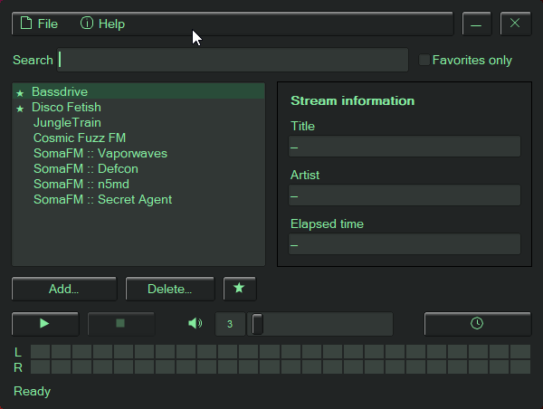

# 📻 Screacher Radio

A small, lightweight web radio player with a minimalistic interface.



## ✨ Features

- 🖥️ Windows & Linux support
- 🪶 Minimalistic UI
- 📻 Station list with search and favorites
- 🎵 Direct MP3 streams and M3U / PLS playlists
- 🔽 Tray icon and minimize to tray
- ⏲️ Sleep timer with presets and extensions
- 🎧 Audio-device selection
- 🎨 Simple themes: Standard, Dark & Light
- ⏯️ Configurable Play/Pause media key: playback control or show/minimize the player
- 🔁 Optional autoplay of the last station
- 🔊 Volume control, mute & stereo level meters
- 📝 Track information when available
- 🌍 English & German interface

## 🚀 Getting started

**No installation required.** Download your platform's binary from [Releases](https://github.com/tobiasnebel/screacher-radio/releases) and keep it in a folder of your choice.

- **Windows:** Run `screacher-radio-windows-x86_64.exe`.
- **Linux:** Extract `screacher-radio-linux-x86_64.tar.gz`, make the binary executable with `chmod +x screacher-radio`, then run `./screacher-radio`. See the [Linux notes](docs/README.md#linux) for required system libraries.
- **Optional:** Place `stations.yaml` next to the executable to start with a prepared station list. The file is also available as a release download.

Add your own stations through **File → Add station** or edit the station list below.

## 📻 Your station list

Stations and favorites are stored in **`stations.yaml` next to the executable**. You can use the [included station list](media/station_lists/stations.yaml) or create your own:

```yaml
- name: My radio station
  url: https://example.org/live.mp3
  favorite: true
- name: My playlist station
  url: https://example.org/radio.m3u
  favorite: false
```

Replace these example URLs with your stations' HTTP(S) addresses. Direct MP3 streams and M3U / PLS playlists are supported; a playlist is treated as one station and plays its first stream.

The player saves changes to this file, so its folder must be writable. Close the player before editing the YAML manually. You can take the list with you by copying it alongside the executable.

## 📚 Further documentation

The [original README](docs/README.md) contains detailed usage notes, build instructions and platform requirements (in German).
